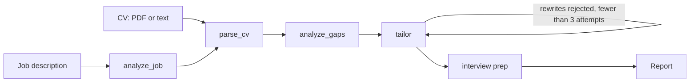

# Career Coach: a fact-checked multi-agent job-application assistant

Upload a CV (PDF or text) and paste a job description. The system returns a **gap analysis**, **tailored CV bullets** and **interview preparation**, and every claim it makes is checked against the original CV.


## Why this project

LLM résumé tools can easily invent experience. This one is built around the opposite goal: **every claim must point to evidence in the CV**, and a separate judge verifies that the evidence really supports the claim. The interesting part is how that was measured and improved (see [Results](#results) and [Failures I found and fixed](#failures-i-found-and-fixed)).

## Architecture



Built with LangGraph. Each node returns a Pydantic-validated object, and an automatic repair loop fixes invalid JSON.

| Node           | Output                                                                     | Safeguards against invention                                                                                                                                                                                                                                                                    |
| -------------- | -------------------------------------------------------------------------- | ----------------------------------------------------------------------------------------------------------------------------------------------------------------------------------------------------------------------------------------------------------------------------------------------- |
| `analyze_job`  | `JobProfile`: must-have skills, nice-to-have skills, and soft requirements | Prompt: use only what is written. Personality traits ("attention to detail") go to `soft_skills` and are not scored                                                                                                                                                                             |
| `analyze_gaps` | `GapReport` (match / partial / missing + evidence)                         | Evidence must be an exact quote from the CV (checked in code, Unicode-normalised). [IF grep found it: The prompt asks for project evidence over a Skills-list line, which is only "partial". This is a prompt rule, not enforced in code.]                                                      |
| `tailor`       | Reworded CV bullets (up to 6)                                              | The original must exist in the CV; a rewrite may not add skills (code check); an **LLM judge** checks every rewrite; [IF grep found it: the judge also checks that each bullet really demonstrates the requirement it is labelled with;] rejected rewrites go back with feedback (max 3 rounds) |
| `interview`    | Questions, answer points, "think about before the interview" prompts       | Every answer point needs a short exact quote from the CV and the judge verifies it supports the point. Gap questions are learning plans, never claims                                                                                                                                           |

The judge sees each (claim, evidence) pair and rejects claims that add a tool, technique, number, purpose or level of expertise that the evidence does not state.

**Coverage score.** The percentage in the UI is computed over concrete must-have requirements only (partial counts as half). Soft requirements are listed separately because they cannot be proven from a CV.

## PDF input

PDFs are read **locally** with `pypdf`; the file is never sent to the LLM provider. Emails, phone numbers and links are removed automatically, and the extracted text appears in an editable box so you can fix it before analysis. Limits: 5 pages, 5 MB, no scanned (image-only) PDFs, no password-protected files.

## Results

### Judge calibration

32 hand-labelled (claim, evidence) pairs written from a real CV: 16 supported, 16 unsupported. Positive class = "unsupported claim". Each model ran 3 times with caching disabled.

| Model        | Precision | Recall | Cases whose verdict changed between runs |
| ------------ | --------- | ------ | ---------------------------------------- |
| gpt-oss-120b | 1.00      | 0.98   | 1                                        |
| gpt-oss-20b  | 1.00      | 1.00   | 0                                        |

The difference is one verdict out of 48, which is within noise. **These numbers are a sanity check, not proof of accuracy**: the set is small, it was labelled by the author, and part of it was built from failures I had already observed. The set grows each time a new failure appears. Reproduce with `python -m eval.compare_models`. Latency is noisy on a free tier, so I do not report it.

### Real-world check

The sample files hid problems that appeared on the first run with a real CV and a real LinkedIn posting (the posting is third-party text and is not included in this repo). Coverage was 25% (2 of 10 "requirements" matched) because soft traits and unrelated interests ("interest in gaming") were scored as missing skills. After separating soft requirements, coverage is computed over 5 concrete must-haves (4 matched). Note that this changes what the number means; it is not an accuracy improvement.

Requirement-extraction accuracy (`eval/eval_jobs.py`) is **not measured yet**: the script exists, but I have not labelled enough real postings.

## Failures I found and fixed

1. **Evidence that exists but does not prove the claim.** A first check only verified that the quoted evidence appears in the CV. A certificate title was accepted as proof of RAG experience. Fix: prompt rule, and later an LLM judge that checks the _meaning_ of the evidence.
2. **Inflated interview answers.** The coach wrote "Chose Chroma for its Python API" with the Skills line as evidence, an invented rationale. Fix: one evidence quote per answer point, plus the judge.
3. **A judge that was too strict.** After adding the judge, five technical questions ended up with no answers because harmless paraphrases were rejected. Fix: calibrated the prompt with accept/reject examples and measured it on the labelled set.
4. **Invisible Unicode.** A bullet was dropped as "not found in the CV" because the model returned a non-breaking hyphen. Fix: Unicode normalisation before comparing, with a regression test.
5. **Silent truncation.** Interview prep returned 2 questions instead of 8: the response was cut off by the token limit and my JSON auto-repair silently closed it. Fix: higher limit and a warning when `finish_reason == "length"`.
6. **Stale cache.** The cache key ignored the schema, and `NO_CACHE` only skipped _writing_, so my "3 runs" could have replayed cached answers. Fix: schema in the key, `NO_CACHE` skips reads too, and the evaluation was rerun.
7. **Soft traits scored as missing skills; copy-paste "tailoring".** On a real posting, every tailored bullet carried the same requirement label and several were identical to the original. Fix: soft requirements are a separate field, the tailor picks at most 6 bullets with distinct labels from the allowed list, and bullets it cannot improve are skipped.
8. **An untested node.** `analyze_gaps` crashed on the first real run because no test covered it. Fix: added tests that mock the model, including one for evidence containing a non-breaking hyphen.
9. [IF grep found it: **Wrong requirement label.** A JWT/Swagger bullet was labelled as evidence for SQL, because the label check only verified that the skill name was in the job's list. Fix: the judge now verifies that the bullet demonstrates the skill it is tagged with.]

## Limitations

- The judge is an LLM and can be wrong; the evaluation set is small. On a real run it approved a claim whose only evidence was a Skills-section line ("I built backend services using Node.js..."), and that case was added to the calibration set.
- Match / partial / missing is a model judgement and can vary between runs even at temperature 0.
- Grounding is checked by exact quotation, so a faithful but loosely quoted evidence line may be rejected.
- When a CV already fits the job, "tailoring" is mostly small rewording. The tool selects and sharpens bullets, it does not create new ones.
- PDF text extraction depends on the layout: multi-column or designed CVs can come out in a scrambled order, which is why the extracted text is editable.
- Quality depends on the model, and free-tier models are rate limited.

## Privacy

- Text is sent to the configured LLM provider, so check the extracted text and remove anything sensitive. Free tiers of some providers may use requests to improve their products.
- Phone numbers, emails and links are removed from uploaded PDFs automatically, but names and employers are not.
- The app writes no user text to its cache. Uploaded files are held by Gradio in a temporary folder and deleted after about a minute.
- The sample CV in `data/` is the author's, with contact details removed. The sample job posting is synthetic.

## Run it

```bash
git clone https://github.com/Edenalster/career-coach.git
cd career-coach
python3 -m venv .venv && source .venv/bin/activate
pip install -r requirements.txt
cp .env.example .env        # then fill in your provider details
python app.py               # http://127.0.0.1:7860
```

Docker:

```bash
docker build -t career-coach .
docker run --rm -p 7860:7860 --env-file .env career-coach
```

Any OpenAI-compatible provider works (Groq, Mistral, OpenRouter, ...), as do Gemini and a local Ollama model. Switch with environment variables only; see `.env.example`.

## Tests and evaluation

```bash
python -m pytest -q                                  # no API key needed: the LLM is mocked
python -m eval.compare_models                        # judge precision/recall per model
python -m eval.eval_judge eval/judge_cases_hard.json
python -m eval.eval_jobs                             # needs your own labelled postings in eval/jobs/
```

Tests run in CI on every push (GitHub Actions), including a Docker build. `conftest.py` points the LLM client at a fake endpoint, so tests can never call a real provider.

## Project layout

```
src/career_coach/
  schemas.py        Pydantic models
  llm.py            provider wrapper: Gemini / OpenAI-compatible / Ollama, retries, repair loop
  grounding.py      exact-quote checks (Unicode-normalised)
  validator.py      LLM claim judge
  pdf_utils.py      local PDF text extraction and redaction
  graph.py          LangGraph pipeline with retry loop
  nodes/            job_analyzer, cv_parser, gap_analyzer, cv_tailor, interview_coach
eval/               judge calibration sets, model comparison, extraction eval
tests/              pytest (mocked LLM)
app.py              Gradio UI
Dockerfile, .github/workflows/tests.yml
```

Stack: Python, LangGraph, Pydantic, Gradio, pypdf, Docker, pytest, GitHub Actions.
